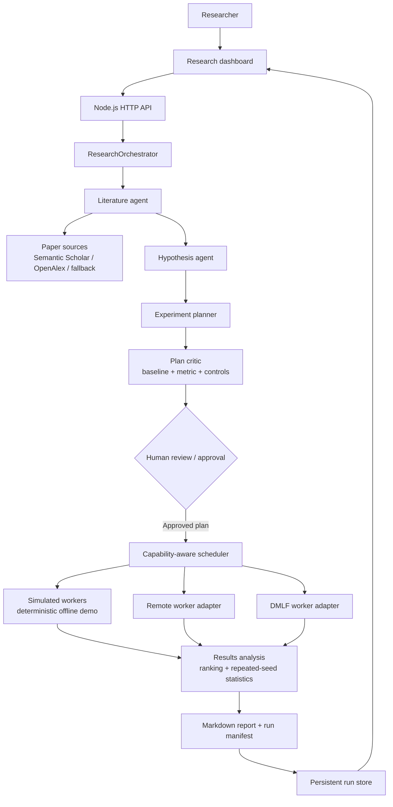
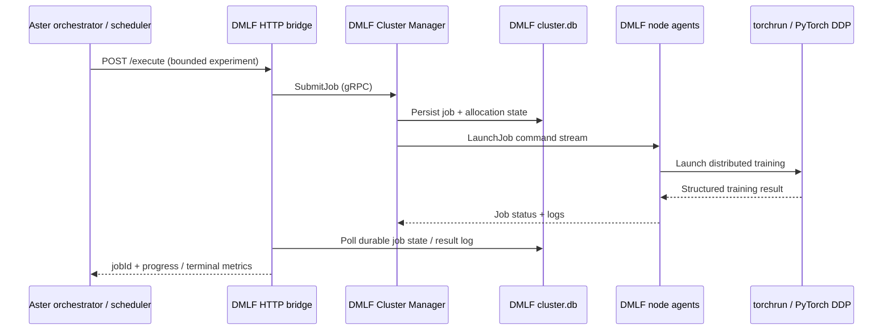
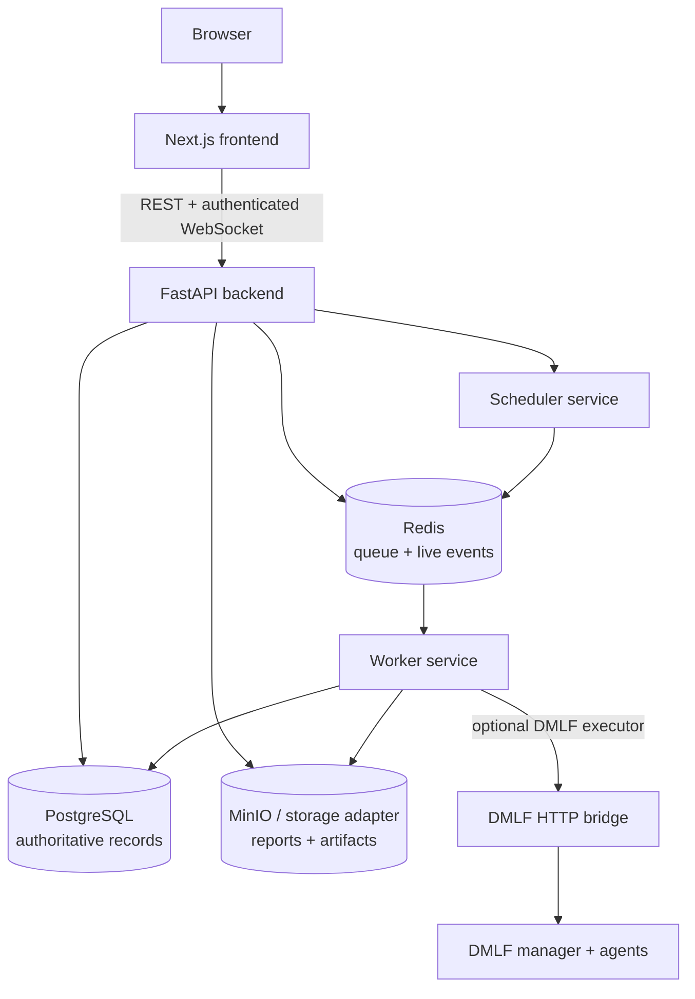

# Aster — Distributed AI Research Scientist

> An auditable, human-approved AI research workflow that transforms a research question into a literature brief, testable hypothesis, bounded experiment plan, distributed execution, result analysis, and a reproducible Markdown report.

<p align="left">
  
  
  
  
</p>

Aster is deliberately scoped as a hackathon/demo implementation. It uses deterministic local agents by default, so the end-to-end flow can be explored without model credentials. Set `OPENAI_API_KEY` to switch the literature, hypothesis, and report agents to the OpenAI Responses API.

## Project at a glance

| Stage | Responsibility |
|---|---|
| Research intake | Capture question and experiment budget |
| Literature | Gather paper metadata and abstracts |
| Hypothesis | Produce a testable research hypothesis |
| Planning | Create bounded experiment specifications and critique the plan |
| Execution | Schedule local simulated workers or connect to DMLF |
| Analysis | Compare experiment results and rank outcomes |
| Reporting | Generate a Markdown report with evidence labels and limitations |

## Architecture

Aster has two related execution surfaces in this repository: the lightweight Node.js research-demo orchestrator and the fuller FastAPI platform stack. Both preserve a bounded research-plan contract; the DMLF integration delegates actual distributed training to the separate cluster manager and node agents.

### 1. Research workflow and agent responsibilities



The default Node.js demo uses deterministic local agents and simulated workers when no OpenAI credentials are configured. With `OPENAI_API_KEY`, the literature, hypothesis and report synthesis calls use the Responses API. Paper retrieval is optional and can use Semantic Scholar with OpenAlex fallback. The plan critic emits caveats and marks that human approval is required; model-generated text does not directly execute commands.

### 2. Distributed execution boundary



Aster's bridge adapts the DMLF job interface; it does not replace DMLF scheduling or invent worker capacity. DMLF remains responsible for node allocation, launch, retry handling and training execution. The research application polls the asynchronous job contract and labels synthetic smoke-test results separately from benchmark evidence.

### 3. Platform service architecture

The optional platform stack is a separate service-oriented backend, not the same process as the Node.js demo API.



| Service | Responsibility |
|---|---|
| Next.js frontend | Research, projects, jobs, reports and worker views |
| FastAPI backend | Authentication, ownership checks, research/job APIs and artifact access |
| PostgreSQL | Durable users, projects, runs, jobs, events and artifact metadata |
| Redis | Work queue and live-event channels |
| Scheduler / worker | Publish queued jobs and execute allowlisted job types |
| Storage adapter | Persist report and artifact bodies (MinIO or configured local fallback) |
| DMLF bridge | Optional hand-off to the existing distributed training cluster |

### 4. Evidence and execution modes

| Mode | What it demonstrates | Evidence interpretation |
|---|---|---|
| Deterministic local agents + simulated workers | End-to-end research orchestration without credentials | Simulated metrics |
| OpenAI-backed synthesis | Model-assisted literature, hypothesis and report text | Generated reasoning; validate against primary sources |
| Remote worker | Asynchronous external execution through a bounded HTTP contract | Depends on worker-reported metrics and provenance |
| DMLF + PyTorch DDP | Actual distributed training through registered nodes | Real execution; synthetic data is not benchmark evidence |


## Demo in 60 seconds

```powershell
npm test
npm start
```

In another terminal:

```powershell
Invoke-RestMethod -Method Post http://localhost:3000/runs -ContentType 'application/json' -Body '{"question":"Does augmentation improve a small image classifier?","budget":{"maxExperiments":3,"maxEpochs":8}}'
```

Use `GET /runs/:id` to inspect the research timeline and `GET /runs/:id/report` to retrieve the Markdown report.

No API key, package install, or internet connection is required for this default path. It is an offline, deterministic orchestration demo, so its metrics are visibly marked **simulated**.

## One-command Docker demo

To start the dashboard, DMLF manager, asynchronous bridge, and two CPU worker agents together:

```powershell
docker compose up --build
```

Then open `http://localhost:3000/`. The Compose stack is preconfigured for the two-node synthetic DDP smoke test. See [docker-compose.md](docs/docker-compose.md) for the exact flow, reset command, and multi-machine boundary.

For a real two-physical-machine DDP recording, use the [two-machine DMLF runbook](docs/two-machine-demo.md). It starts one manager/bridge/dashboard on Machine A and one native DMLF agent on each machine.

## Real two-machine DDP demo

Use this path when you want to show two physical computers participating in one DDP job. Keep both devices on the same LAN and use their physical Wi-Fi or Ethernet adapter (not VPN/WSL/virtual adapters).

### 1. Prepare both machines

Clone the repository on both machines, then create the DMLF environment from the nested project directory:

```powershell
cd .\AI-Research-Scientist\Distributed-ML-Training-main\Distributed-ML-Training-main
py -m venv .venv
.\.venv\Scripts\python.exe -m pip install -r requirements.txt
```

Find each machine's LAN IPv4 address with `ipconfig`, and find its active adapter name with:

```powershell
Get-NetAdapter | Where-Object Status -eq Up | Select-Object Name, InterfaceDescription
```

On both machines, allow inbound DDP rendezvous traffic. On Machine A, also allow the DMLF manager port. Run PowerShell as Administrator:

```powershell
New-NetFirewallRule -DisplayName 'DMLF DDP Rendezvous' -Direction Inbound -Protocol TCP -LocalPort 20000-39999 -Action Allow
New-NetFirewallRule -DisplayName 'DMLF Manager gRPC' -Direction Inbound -Protocol TCP -LocalPort 50051 -Action Allow
```

### 2. Start Machine A (manager machine)

Replace the address and adapter name with Machine A's actual LAN values, then save the configuration:

```powershell
.\setup-dmlf-node.ps1 -ManagerAddress '10.xx.xx.xx:50051' -AdvertiseIp '10.xx.xx.xx.53' -GlooInterface 'Wi-Fi'
```

Open four terminals:

```powershell
# DMLF directory: terminal 1, 2, and 3
.\start-dmlf-manager.ps1
.\start-dmlf-bridge.ps1
.\start-dmlf-node.ps1

# Repository root: terminal 4
npm.cmd start
```

### 3. Start Machine B (worker machine)

Check that it can reach Machine A's manager, then configure and start its agent. Replace the example IPs and adapter name:

```powershell
.\.venv\Scripts\python.exe -m dmlf.preflight --manager 10.103.63.53:50051
.\setup-dmlf-node.ps1 -ManagerAddress '10.xx.xx.xx:50051' -AdvertiseIp '10.xx.xx.xx.32' -GlooInterface 'Wi-Fi'
.\start-dmlf-node.ps1
```

The preflight result must show `"reachable": true` before continuing.

### 4. Run the video demo

On Machine A, open `http://localhost:3000/dmlf`, wait for two `IDLE` nodes, then enable DMLF with bridge endpoint `http://127.0.0.1:8002` and `2` required nodes.

On the research dashboard, select **DMLF synthetic - execution smoke test** and use:

> Does an offline DMLF synthetic classifier execute correctly across two distributed workers?

Set one experiment, one epoch, and one seed repetition. Preview the plan, run it, and show the job assignment, live progress, real `validation_accuracy`, report, and manifest. The metric validates real distributed execution on synthetic data; it is not benchmark evidence.

To review the proposed literature brief, hypothesis, and experiment configuration before scheduling workers, submit the same request to `POST /runs/preview`. Preview records are deliberately not persisted or executed.

## OpenAI configuration

```powershell
$env:OPENAI_API_KEY = '...'
$env:OPENAI_MODEL = 'gpt-5.6' # preserve this hackathon target, or set an available model in your account
npm start
```

No SDK is required: the OpenAI adapter calls the Responses API directly. The app safely falls back to deterministic local agents if the key is absent. Do not expose `OPENAI_API_KEY` to browsers or commit it.

Copy `.env.example` to `.env` and populate only the settings you need. This MVP reads environment variables from the shell, so load `.env` through your preferred local environment tool or set them directly in PowerShell.

## How we used Codex and GPT-5.6

**Codex** was used as the development collaborator for this project: it helped design the multi-agent architecture, scaffold the Node.js dashboard and API, implement the asynchronous DMLF bridge contract, add the DMLF configuration UI, write the Docker and two-machine setup, and build regression tests and submission documentation.

**GPT-5.6** is the optional reasoning layer behind the research agents. When `OPENAI_API_KEY` is configured, the app uses the Responses API with `OPENAI_MODEL=gpt-5.6` for bounded literature synthesis, falsifiable hypothesis generation, and final report drafting. The generated output is converted into inspectable research artifacts; it never receives shell access, credentials, or direct worker-control authority.

The default public demo intentionally runs with no API key. In that mode, deterministic local agents preserve the identical plan-review, scheduler, reporting, and manifest contracts so the full project remains runnable offline. The run manifest records the active provider, model setting, and prompt versions so a judge can distinguish model-backed and offline-fallback runs.

Optional paper retrieval uses the [Semantic Scholar Academic Graph API](https://api.semanticscholar.org/api-docs/graph). Set `PAPER_SEARCH_ENABLED=true` to retrieve up to five paper metadata records before synthesis; an API key can be supplied through `SEMANTIC_SCHOLAR_API_KEY` if available. Retrieval failure falls back safely to offline-demo mode.

Semantic Scholar may return HTTP 429 when rate-limiting requests. Successful searches are cached locally for five minutes; avoid repeated searches for the same question, wait for the retry interval if supplied, or configure `SEMANTIC_SCHOLAR_API_KEY`. When Semantic Scholar has no usable response, the app automatically tries the [OpenAlex Works API](https://developers.openalex.org/api-reference/works/list-works); set `OPENALEX_SEARCH_ENABLED=false` to disable that fallback.

When retrieval is enabled, use **Find papers for this question** in the dashboard and explicitly check only the metadata records you approve. The selected records, benchmark definition, prompt versions, active model setting, and paper-review decision are saved in the run manifest.


## Submission-ready demo paths

| Path | What it proves | Requirements | Evidence label |
| --- | --- | --- | --- |
| Offline dashboard | Research planning, review gates, scheduling, auditability, reports | `npm.cmd start` | Simulated |
| DMLF synthetic two-node | Real asynchronous DDP coordination across two machines | Two running DMLF nodes | Real execution; not benchmark evidence |
| DMLF MNIST | Real DDP training on a public dataset | Two running nodes plus MNIST download on each node | Real benchmark run |

For a reliable short recording, use the **DMLF synthetic two-node** path: it proves distributed execution without depending on dataset download. Select **DMLF synthetic - execution smoke test**, set one experiment, one epoch, and one seed repetition. The report will correctly preserve the synthetic-data limitation.

For setup and recording steps, see the [two-machine demo guide](docs/two-machine-demo.md) and [Docker Compose guide](docs/docker-compose.md).


## Real DMLF distributed execution

The included `Distributed-ML-Training-main` project is integrated as an optional `dmlf` worker. It preserves the existing DMLF Cluster Manager, node allocation, gRPC node agents, `torchrun`, and PyTorch DDP; the added bridge only adapts DMLF's durable job state to this dashboard's asynchronous worker protocol. Follow [dmlf-integration.md](docs/dmlf-integration.md) to run the CPU-safe MNIST proof locally or connect multiple DMLF nodes.

Open [the DMLF configuration dashboard](http://localhost:3000/dmlf) after starting the app to enable or disable DMLF execution, set the bridge and manager addresses, choose the requested node count, and plan CPU/GPU nodes. The live registry is read from the DMLF bridge and remains authoritative: planned nodes do not replace node-agent hardware discovery.

To replace the default simulators, configure trusted server-side worker definitions before starting the app. For example:

```powershell
$env:WORKER_CONFIG_JSON = '[{"type":"remote","id":"gpu-lab-02","endpoint":"https://worker.example/execute","capabilities":["cpu","gpu"],"slots":1,"token":"server-side-token"}]'
npm.cmd start
```

